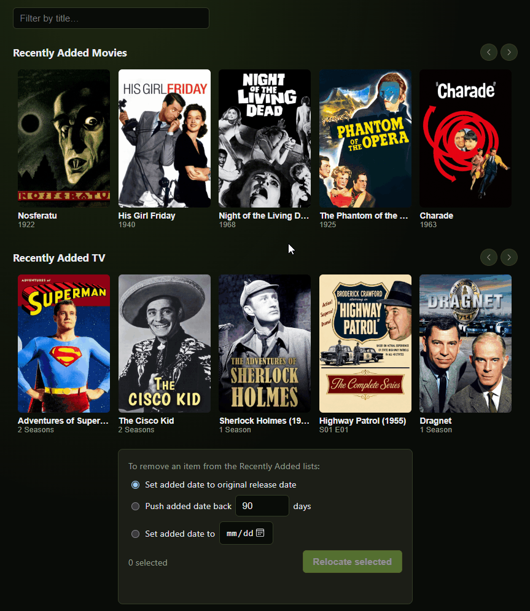

# PEAR

**P**lex **E**ntity added**A**t **R**elocator

DockerHub Link: https://hub.docker.com/r/audiophonicz/pear

Encountered a bug, or have a feature request? Log it here: https://github.com/audiophonicz/pear/issues


## What is PEAR?
Have you ever moved your folders, upgraded storage, or re-encoded your media just to have Plex do an inopportune scan, and add something you've had forever back to Recently Added on your dashboard? Does that bother your OCD? Do you wish there was a quick and easy point-and-click way to fix that? Then PEAR is for you! PEAR allows you to connect to your Plex server and move or remove movies, episodes, seasons, or entire series in the Recently Added Movies and TV Shows lists.

## How do I use PEAR?
PEAR runs entirely in your browser. There is no backend server beyond a
static file host — the app calls `plex.tv` for sign-in and your Plex Media
Server directly for everything else, the same way Plex Web itself does.
Nothing is sent to any third party.

Two ways to connect:

- **Sign in with Plex** — standard email and password auth, then pick a
  discovered server (with a "prefer local address" option, same idea as
  connecting from Plex Web on your home network).
- **Connect manually** — type a server address and an `X-Plex-Token`
  directly, for servers that don't show up in discovery (custom domains,
  relay-only, firewalled, etc).

Once logged in you'll see the same Recently Added Movies and TV Shows lists you'd see on your classic Plex dashboard, up to date and complete with posters. Simply select one or more items from either or both lists, select a relocation option, and click the Relocate button! You can relocate based on the original release date of the item (according to plex), push (add) a specified amount of days to its current addedAt value, or select a specific date using the calender popup.


<p align="center">
  
</p>


## About PEAR
I've been using cglatot's [PASTA](https://github.com/cglatot/pasta) tool for years, and love how simple it is to use. When I went to figure out how to fix some erroneous items in my Recently Added lists, all I found was installing entire cli tools to do a simple task, or some containers specific for my need but havent been updated in forever, or worse yet, the suggestion to edit a SQLite DB directly. I was accustomed PASTA and wanted something just as easy to use. So, in homage to PASTA, I set out with my trusty claude-code to build a companion app with a similar look and feel, that can be used to quickly and easily fix those one-off mistakes and put your OCD at ease. If you like PEAR,
go check out [PASTA](https://github.com/cglatot/pasta) too.


## Running PEAR

### Docker Run Example:  

```bash

docker run -d -p 8088:80 --name pear ghcr.io/audiophonicz/pear:latest

```


### Docker Compose Example: 

```yaml

---
version: "3"

services:
  pear:
    image: ghcr.io/audiophonicz/pear:latest
    container_name: pear
    ports:
      - "8088:80"
    restart: unless-stopped

```


### Kubernetes Manifest Example:

```yaml

cat <<"EOF" | kubectl apply -f -
#pear-namespace.yml
apiVersion: v1
kind: Namespace
metadata:
  name: pear-namespace
---
#pear-deployment.yml
apiVersion: apps/v1
kind: Deployment
metadata:
  labels:
    app.kubernetes.io/name: pear
  name: pear
  namespace: pear-namespace
spec:
  replicas: 1
  selector:
    matchLabels:
      app.kubernetes.io/name: pear
  strategy:
    type: Recreate
  template:
    metadata:
      labels:
        app.kubernetes.io/name: pear
    spec:
      automountServiceAccountToken: true
      containers:
      - name: pear
        image: ghcr.io/audiophonicz/pear:latest
        imagePullPolicy: IfNotPresent
        livenessProbe:
          failureThreshold: 3
          periodSeconds: 10
          successThreshold: 1
          httpGet:
            path: /
            port: 80
        ports:
        - containerPort: 80
          protocol: TCP
        readinessProbe:
          failureThreshold: 3
          periodSeconds: 10
          successThreshold: 1
          httpGet:
            path: /
            port: 80
        resources: {}
        startupProbe:
          failureThreshold: 3
          periodSeconds: 10
          successThreshold: 1
          httpGet:
            path: /
            port: 80
        terminationMessagePath: /dev/termination-log
        terminationMessagePolicy: File
      dnsPolicy: ClusterFirst
      hostname: pear
      restartPolicy: Always
      schedulerName: default-scheduler
      terminationGracePeriodSeconds: 30
---
#pear-svc.yml
apiVersion: v1
kind: Service
metadata:
  labels:
    app.kubernetes.io/name: pear
  name: pear-svc
  namespace: pear-namespace
spec:
  ports:
  - port: 80
    protocol: TCP
    targetPort: 80
  selector:
    app.kubernetes.io/name: pear
  sessionAffinity: None
  type: ClusterIP
---
#pear-redirect_httproute.yml
apiVersion: gateway.networking.k8s.io/v1
kind: HTTPRoute
metadata:
  name: pear-redirect
  namespace: pear-namespace
spec:
  parentRefs:
  - name: main-gateway
    namespace: gateway-system
    sectionName: web          # Only attach to HTTP listener

  hostnames:
  - "pear.k3s.example.com"

  rules:
  - matches:
    - path:
        type: PathPrefix
        value: /
    filters:
    - type: RequestRedirect
      requestRedirect:
        scheme: https
        statusCode: 301
---
#pear-route_httproute.yml
apiVersion: gateway.networking.k8s.io/v1
kind: HTTPRoute
metadata:
  name: pear-route
  namespace: pear-namespace
  labels:
    app.kubernetes.io/name: pear
    app.kubernetes.io/instance: pear
spec:
  parentRefs:
  - name: main-gateway
    namespace: gateway-system
    sectionName: websecure     # Only attach to HTTPS listener

  hostnames:
  - "pear.k3s.example.com"

  rules:
  - matches:
    - path:
        type: PathPrefix
        value: /
    backendRefs:
    - name: pear-svc
      port: 80
EOF

```

## Notes

- Relocating `addedAt` also locks the field (`addedAt.locked=1`) so a future
  library scan won't silently revert it back to the original added date.
- This edits Plex's own metadata for the item, not the file on disk — nothing
  about your media files changes.
- Max List Items setting controls how many fetched items are displayed. PEAR fetches a fixed 100 items from each Recently Added list. This is to account for collapsing multiple episodes/seasons.


